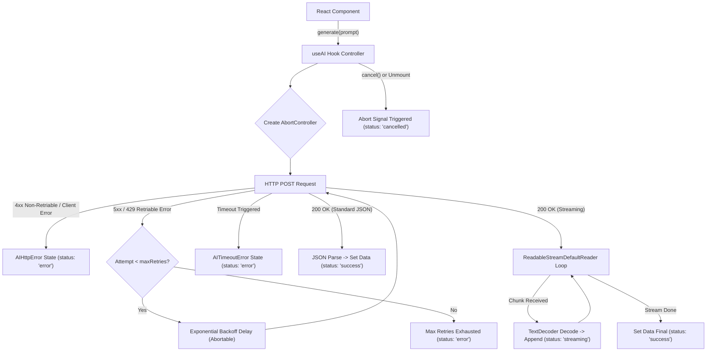
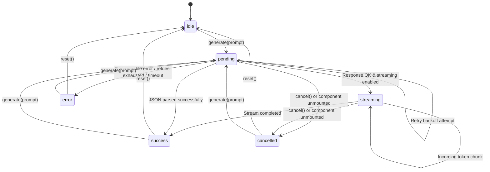

# @shrey/react-ai

[](https://www.npmjs.com/package/@shrey/react-ai)
[](https://opensource.org/licenses/MIT)
[](https://www.typescriptlang.org/)
[](https://webpack.js.org/guides/tree-shaking/)

Production-grade, zero-dependency React hook for managing AI/LLM request lifecycles, real-time token streaming via `ReadableStream`, abortable exponential-backoff retries, and strict lifecycle state machines.

---

## Features

- ⚡ **Dual Format Distribution**: Native ESM (`.js`) and CommonJS (`.cjs`) with strict TypeScript type definitions (`.d.ts`, `.d.cts`).
- 🌊 **First-Class Streaming**: Smooth real-time token accumulation via `ReadableStreamDefaultReader` and `TextDecoder`.
- 🔁 **Resilient Retry Mechanism**: Automatic exponential backoff for transient HTTP errors (`408`, `429`, `500`, `502`, `503`, `504`).
- 🛑 **Abortable Lifecycles**: Preemptive cancellation via `AbortController`, with automatic teardown on unmount and delay aborts.
- ⏱️ **Timeout Protection**: Strict per-request timeout handling with distinct, typed `AITimeoutError`.
- 🎯 **Predictable State Machine**: Unidirectional transitions across `idle`, `pending`, `streaming`, `success`, `error`, and `cancelled`.
- 🌳 **Zero Bloat & Tree-Shakeable**: Configured with `"sideEffects": false` and strict peer dependency bounds for React 18 & 19.

---

## Architecture

The following diagram illustrates how `@shrey/react-ai` orchestrates network requests, stream decoding, retries, and state transitions within your React application:



---

## Lifecycle State Machine

The hook guarantees deterministic state progression through the following finite state machine:



---

## Installation

```bash
# npm
npm install @shrey/react-ai

# pnpm
pnpm add @shrey/react-ai

# yarn
yarn add @shrey/react-ai
```

### Peer Dependencies

Ensure your project has `react` installed:

```json
{
  "peerDependencies": {
    "react": "^18.0.0 || ^19.0.0",
    "react-dom": "^18.0.0 || ^19.0.0"
  }
}
```

---

## Quick Start

### 1. Standard JSON Request

```tsx
import React, { useState } from 'react';
import { useAI } from '@shrey/react-ai';

export function ChatComponent() {
  const [prompt, setPrompt] = useState('');
  const { data, status, error, isPending, generate, reset } = useAI<string>({
    endpoint: '/api/ai/generate',
    retry: 2,
    retryDelay: 1000,
    timeout: 10000,
  });

  return (
    <div>
      <input
        value={prompt}
        onChange={(e) => setPrompt(e.target.value)}
        disabled={isPending}
        placeholder="Enter your prompt..."
      />
      <button onClick={() => generate(prompt)} disabled={isPending || !prompt}>
        {isPending ? 'Generating...' : 'Submit'}
      </button>
      <button onClick={reset}>Reset</button>

      {status === 'error' && <p className="error">{error?.message}</p>}
      {status === 'success' && <div className="result">{data}</div>}
    </div>
  );
}
```

### 2. Real-Time Token Streaming

```tsx
import React, { useState } from 'react';
import { useAI } from '@shrey/react-ai';

export function StreamingChat() {
  const [prompt, setPrompt] = useState('');
  const {
    data,
    status,
    isStreaming,
    isPending,
    generate,
    cancel,
    retryAttempt,
  } = useAI<string>({
    endpoint: '/api/ai/stream',
    streaming: true,
    retry: 1,
    timeout: 15000,
  });

  const isBusy = isPending || isStreaming;

  return (
    <div>
      <textarea
        value={prompt}
        onChange={(e) => setPrompt(e.target.value)}
        disabled={isBusy}
        placeholder="Ask anything..."
      />
      <div className="controls">
        <button onClick={() => generate(prompt)} disabled={isBusy || !prompt}>
          {isStreaming ? 'Streaming...' : isPending ? 'Connecting...' : 'Generate'}
        </button>
        <button onClick={cancel} disabled={!isBusy}>
          Stop
        </button>
      </div>

      {retryAttempt > 0 && <span>Reconnecting (Attempt {retryAttempt})...</span>}
      {status === 'cancelled' && <p>Generation stopped by user.</p>}
      {data && <div className="stream-output">{data}</div>}
    </div>
  );
}
```

---

## API Reference

### `useAI<T>(options: UseAIOptions): UseAIReturn<T>`

Primary hook managing the lifecycle of AI generation requests.

#### `UseAIOptions`

| Property | Type | Default | Description |
| :--- | :--- | :--- | :--- |
| `endpoint` | `string` | **Required** | The target API URL where POST requests are dispatched. |
| `streaming` | `boolean` | `false` | When `true`, consumes response as a `ReadableStream` of text tokens. |
| `retry` | `number` | `0` | Number of retry attempts on retriable HTTP errors (`408`, `429`, `5xx`). |
| `retryDelay` | `number` | `1000` | Base delay (in ms) for exponential backoff: `retryDelay * 2^(attempt - 1)`. |
| `timeout` | `number` | `undefined` | Maximum duration (in ms) before aborting with `AITimeoutError`. |

#### `UseAIReturn<T>`

| Property | Type | Description |
| :--- | :--- | :--- |
| `data` | `T \| null` | The generated response data (accumulated string during streaming, or parsed JSON payload). |
| `error` | `Error \| null` | Error instance if request failed (`AIHttpError`, `AITimeoutError`, etc.). |
| `status` | `AIStatus` | Discrete status: `'idle' \| 'pending' \| 'streaming' \| 'success' \| 'error' \| 'cancelled'`. |
| `isPending` | `boolean` | Boolean flag indicating status is `'pending'`. |
| `isStreaming` | `boolean` | Boolean flag indicating status is `'streaming'`. |
| `isSuccess` | `boolean` | Boolean flag indicating status is `'success'`. |
| `isError` | `boolean` | Boolean flag indicating status is `'error'`. |
| `isCancelled` | `boolean` | Boolean flag indicating status is `'cancelled'`. |
| `isTimeout` | `boolean` | Boolean flag indicating whether the failure was caused by timeout. |
| `retryAttempt` | `number` | Current retry attempt index (0 on initial execution). |
| `generate` | `(prompt: string) => Promise<void>` | Dispatches an AI request with the given prompt. Cancels previous in-flight requests. |
| `reset` | `() => void` | Cancels any active request and resets all state variables to initial `'idle'` state. |
| `cancel` | `() => void` | Aborts the active network request or reader and marks status as `'cancelled'`. |

---

## Error Handling

The library provides distinct typed error classes for deterministic error handling:

### `AITimeoutError`

Thrown when request execution exceeds the duration specified in `options.timeout`.

```ts
import { useAI, AITimeoutError } from '@shrey/react-ai';

const { error, isTimeout } = useAI({
  endpoint: '/api/ai',
  timeout: 5000,
});

if (error instanceof AITimeoutError) {
  console.error(`Request timed out after ${error.timeoutMs}ms`);
}
```

### `AIHttpError`

Thrown when the server responds with a non-2xx HTTP status code.

```ts
import { useAI, AIHttpError } from '@shrey/react-ai';

const { error } = useAI({ endpoint: '/api/ai' });

if (error instanceof AIHttpError) {
  console.error(`Server failed with status code ${error.status}`);
}
```

---

## Distribution & Build Verification

`@shrey/react-ai` is built using `tsup` and complies with Modern Node.js Module Resolution (Node16 / NodeNext / Bundler).

- **ESM Entry**: `dist/index.js`
- **CommonJS Entry**: `dist/index.cjs`
- **TypeScript Declarations**: `dist/index.d.ts` & `dist/index.d.cts`
- **Side Effects**: Declared as `false` for optimal bundler tree-shaking.

---

## License

MIT © [Shrey](https://github.com/shrey)
